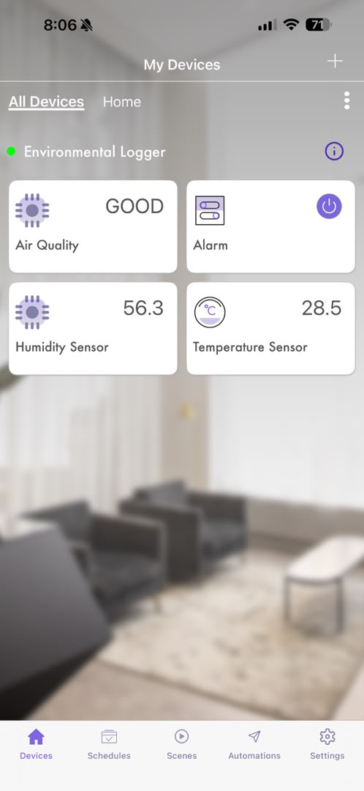
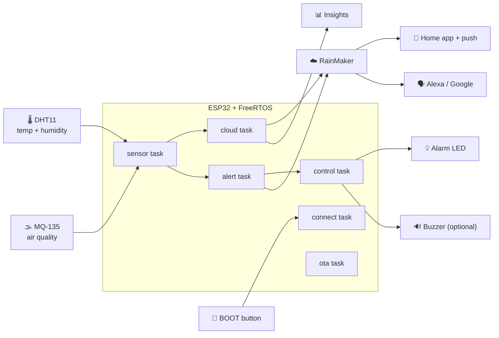
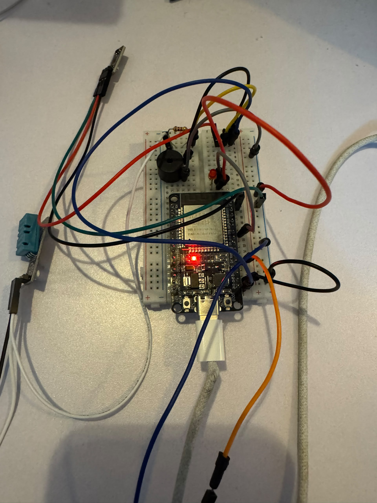
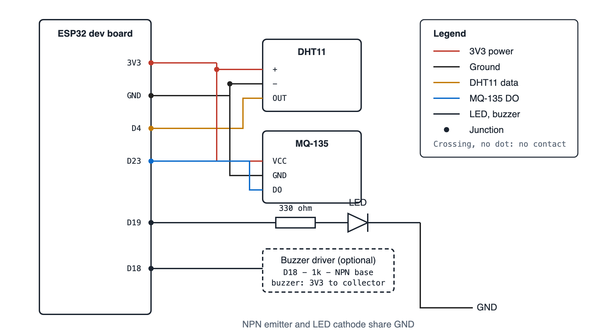

<div align="center">

# 🌡️ Smart Environmental Data Logger 💧

**An ESP32 node that watches temperature, humidity and air quality, alerts your phone, and keeps itself online.**


[🌐 Project website](https://cscscs99.github.io/ENV_DATA_LOGGER_CS/) · [📄 Full report](docs/report.html) · [🎬 Demo video](#-demo) · [🚀 Quick start](#-quick-start)

</div>

> 🎓 **OBE/IBM 5043 – Advanced Embedded Systems**
> 👨‍🏫 Assoc Prof Ir. Dr. Mohd Zuki Yusoff
> 🧑‍💻 Khor Chun Sheng, 26003140

---

## 📖 Table of contents

- [✨ Features](#-features)
- [📱 App preview](#-app-preview)
- [🧭 How it works](#-how-it-works)
- [🔌 Hardware](#-hardware)
- [🧵 Software architecture](#-software-architecture)
- [🚨 Alarm rules](#-alarm-rules)
- [🚀 Quick start](#-quick-start)
- [🔗 Pairing with the phone](#-pairing-with-the-phone)
- [🛡️ Reliability](#️-reliability)
- [🧪 Test checklist](#-test-checklist)
- [🎬 Demo](#-demo)
- [⚠️ Limitations](#️-limitations)

---

## ✨ Features

| | Feature | How it is done |
|---|---|---|
| 📲 | **Live monitoring and control** | Four RainMaker devices: Temperature Sensor, Humidity Sensor, Air Quality, Alarm. Thresholds and the alarm switch are writable from the app. |
| 📊 | **Espressif Insights** | Custom metrics `temp`, `hum`, `air`, `alarm` plus system diagnostics, logs and reboot reasons. |
| 🔔 | **Push notifications** | High temperature, high humidity, poor air quality and failed OTA raise RainMaker alerts, repeated every 60 s while the condition lasts. |
| 🗣️ | **Voice assistant** | Standard temperature-sensor device type: link Alexa or Google Home in the RainMaker app and ask for the temperature. |
| ☁️ | **OTA updates** | Two OTA slots with bootloader rollback. The new image is kept only after it reaches the cloud. |
| 🔘 | **Reset button** | BOOT button: short press re-handshakes with the router, 3 s resets Wi-Fi, 10 s factory-resets. |
| 🔌 | **Power-loss recovery** | Credentials persist in flash. The node rejoins by itself, and a watchdog re-handshakes if the cloud stays unreachable for 30 s. |
| 🧵 | **FreeRTOS tasks** | Seven event-driven tasks. Nothing polls with a blocking delay, and nothing waits for Wi-Fi. |

---

## 📱 App preview

<div align="center">

<br>
<sub>RainMaker Home app: the node is online with all four devices.</sub>
</div>

---

## 🧭 How it works



---

## 🔌 Hardware

<div align="center">

<br>
<sub>Assembled prototype on a breadboard.</sub>
</div>

| 🧩 Part | 📍 ESP32 pin | 🔧 Wiring |
|---|---|---|
| 🌡️ DHT11 module | GPIO4 (D4) | `+` to 3V3, `-` to GND, `OUT` to D4. A bare sensor needs a 10 k pull-up on data. |
| 🌫️ MQ-135 module | GPIO23 (D23) | VCC to 3V3, GND to GND, `DO` to D23. The trimmer pot sets the trip level. DO low means POOR. |
| 💡 Alarm LED | GPIO19 (D19) | D19 to 330 ohm to LED anode, cathode to GND. On only while air quality is POOR. |
| 🔊 Buzzer (optional) | GPIO18 (D18) | D18 to 1 k to NPN base, buzzer between 3V3 and collector, emitter to GND. Off by default. |
| 🔘 BOOT button | GPIO0 | On the dev board, active low. |

<details>
<summary>🗺️ Wiring schematic (click to expand)</summary>



</details>

<details>
<summary>⚡ Power and wiring tips (click to expand)</summary>

- Power the MQ-135 from **3V3** so its DO pin never exceeds 3.3 V. If it reads dead, power it from VIN and put a 10 k / 20 k divider on DO.
- The MQ-135 heater draws noticeable current. A weak USB cable or port can make the ESP32 **brown out** when Wi-Fi starts. Use a short data cable in a direct port.
- Add the sensors **one at a time** and watch the serial log after each.
- Check each module's own pin labels. A swapped data and ground wire on the DHT11 shows up in the log as `data line is stuck LOW`.

</details>

---

## 🧵 Software architecture

| 🧵 Task | ⏱️ Trigger | 🛠️ Work |
|---|---|---|
| `sensor` | esp_timer, every 2 s | Reads the DHT11 and MQ-135 and pushes a sample to the cloud and alert queues. A failed DHT11 read is dropped. |
| `cloud` | cloud queue | Updates RainMaker parameters on change (0.5 °C, 2 %, air state) and at least every 30 s. Adds Insights metrics every 10 s. |
| `alert` | alert queue, 1 s housekeeping | Thresholds with hysteresis, debounced air alarm, push notifications. Holds them while offline. |
| `control` | control queue | Alarm switch, LED and buzzer, Alarm status text. |
| `connect` | event group | Wi-Fi, MQTT and provisioning state, recovery watchdog, button actions. |
| `button` | GPIO interrupt | Short, 3 s and 10 s press detection. |
| `ota` | OTA event queue | Update progress and failure alert. |

<details>
<summary>📂 Source files (click to expand)</summary>

| File | Role |
|---|---|
| `main/app_main.c` | Startup, RainMaker node and device creation, write callback |
| `main/app_sensors.c` | DHT11 bit-bang read and MQ-135 digital read |
| `main/app_cloud.c` | Reports on change or every 30 s, feeds Insights |
| `main/app_alert.c` | Hysteresis alarms, debounced air alarm, notifications |
| `main/app_control.c` | Alarm LED, buzzer, Alarm status text |
| `main/app_connect.c` | Wi-Fi and cloud events, button, recovery watchdog |
| `main/app_ota.c` | OTA progress and failure alert |
| `main/app.h` | Pins, timings, thresholds and build flags |
| `partitions.csv` | Flash layout with two OTA slots |
| `sdkconfig.defaults*` | Build settings: BLE provisioning, Insights, OTA rollback |

</details>

<details>
<summary>⚙️ Build flags in <code>main/app.h</code> (click to expand)</summary>

| Flag | Meaning |
|---|---|
| `BUZZER_ENABLED` | `1` enables the buzzer |
| `AIR_DO_ACTIVE_LOW` | `1` if the MQ-135 module pulls DO low on gas |
| `BLE_ADDR_REROLL` | Offsets the Bluetooth address. Bump it if iOS caches a stale Bluetooth service table and pairing fails |

</details>

---

## 🚨 Alarm rules

| 🎯 Source | ⬆️ Raises | ⬇️ Clears | 💥 Effects |
|---|---|---|---|
| 🌡️ Temperature | at or above threshold (default 35 °C) | below threshold minus 2 °C | App status and push notification |
| 💧 Humidity | at or above threshold (default 80 %) | below threshold minus 5 % | App status and push notification |
| 🌫️ Air quality | MQ-135 trips, after a 30 s warm-up | five good readings in a row | App status, push notification, alarm LED, buzzer if enabled and armed |

The LED and buzzer follow **only the air quality alarm**. Temperature and humidity alarms stay in the app.

---

## 🚀 Quick start

**Requirements:** ESP-IDF v6.1, a classic ESP32 dev board, a data USB cable.

```sh
git clone https://github.com/cscscs99/ENV_DATA_LOGGER_CS.git
cd ENV_DATA_LOGGER_CS

source ~/.espressif/tools/activate_idf_v6.1.sh
idf.py set-target esp32
idf.py -p /dev/cu.usbserial-0001 -b 115200 flash monitor
```

> 💡 Components (RainMaker, Insights, network provisioning) download automatically from `main/idf_component.yml`.
> 💡 Run `idf.py erase-flash` first for a fresh node ID and to clear stored Wi-Fi credentials.
> 💡 Only one program may hold the serial port, and opening it resets the board.

---

## 🔗 Pairing with the phone

1. 📲 Sign in to the **RainMaker Home** app under **ESP RainMaker**.
2. ➕ Tap **Add Device** and scan the QR code printed in the serial log.
3. 📶 Choose a **2.4 GHz** Wi-Fi network and enter its password.

The QR payload looks like `{"ver":"v1","name":"PROV_xxxxxx","username":"wifiprov","pop":"xxxxxxxx","transport":"ble"}`.
The node uses BLE provisioning with the sec2 scheme and assisted claiming, so no certificates are flashed.

---

## 🛡️ Reliability

- 🔌 **Power loss:** Wi-Fi and cloud credentials live in flash. After power returns the node rejoins and reports by itself, in about 15 s in testing.
- 🐶 **Silent cloud failure:** if Wi-Fi is configured but the cloud stays unreachable for 30 s, the watchdog drops and re-establishes the Wi-Fi link.
- 🔘 **Button:** short press re-handshakes, a 3 s hold resets Wi-Fi for re-provisioning, a 10 s hold factory-resets the node.
- 📨 **Offline alerts:** notifications raised while offline stay pending and are sent when the cloud returns.
- 🚫 **Bad sensor data:** a failed DHT11 read is never reported as a value.

---

## 🧪 Test checklist

- [ ] 📲 Provisioning: scan the QR code, four devices appear
- [ ] 🌡️ Live values: warm the DHT11 by hand, values update
- [ ] 🔔 Temperature alert: set the threshold below the reading, notification arrives
- [ ] 🌫️ Air alarm: hold an alcohol swab near the MQ-135, status POOR, LED on, notification
- [ ] ✅ Air clear: remove the source, LED off after five good readings
- [ ] 🔌 Power loss: unplug and replug USB, node returns online by itself
- [ ] 📡 Router loss: switch the router off and on, node reconnects
- [ ] 🔘 Button: hold BOOT for 3 s, Wi-Fi reset and re-provisioning
- [ ] 📊 Insights: metrics and logs visible in the dashboard
- [ ] 🗣️ Voice: ask the linked assistant for the temperature
- [ ] ☁️ OTA: upload a new image, node updates and reconnects

---

## 🎬 Demo

> 🎥 Demo video link: _coming soon_

---

## ⚠️ Limitations

- 🌡️ The DHT11 is accurate to about 2 °C and 5 % RH, and updates at most once per second.
- 🌫️ The MQ-135 digital output only says whether gas is above the trimmer setting. It gives no concentration.
- 🗣️ Alexa and Google Assistant need the RainMaker skill linked once in the phone app.
- 🔊 The buzzer is disabled in firmware by default and needs its transistor wired before enabling.

---

<div align="center">

Made with ❤️ using ESP32, FreeRTOS and ESP RainMaker.

</div>
